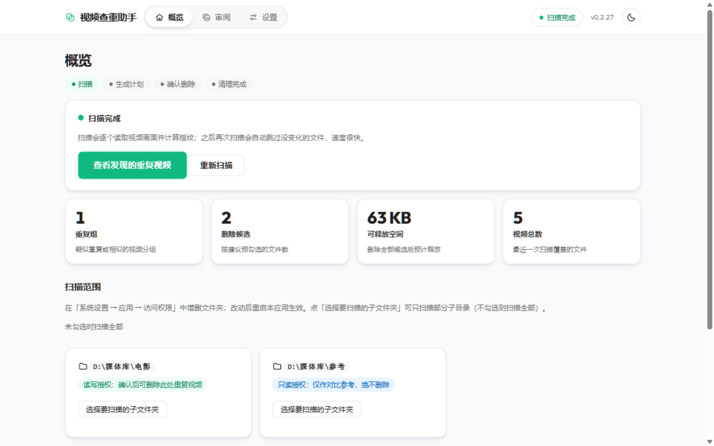
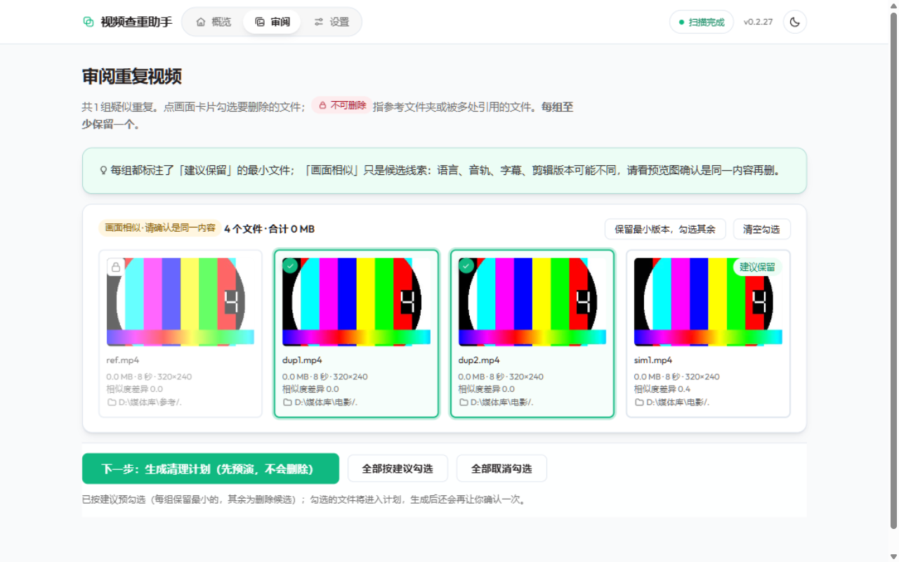
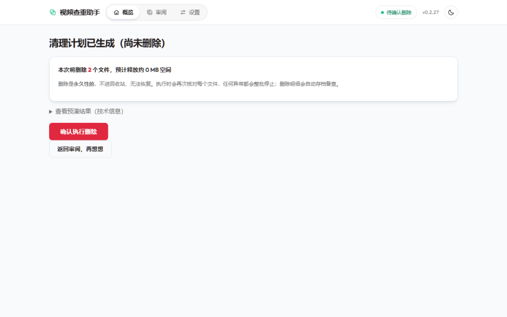
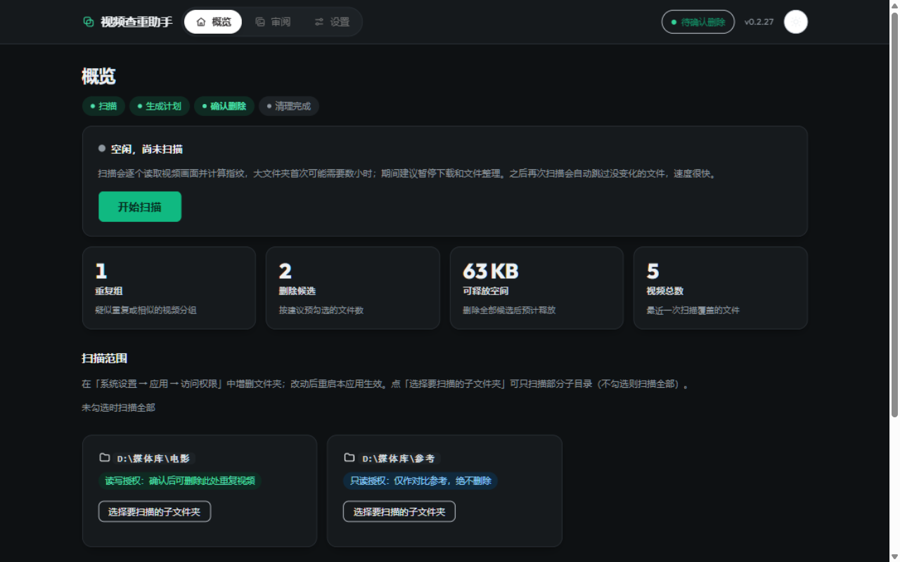

# video-dedupe

[简体中文](README.md) | English

Scans authorized folders on your NAS for videos that are **byte-identical** (SHA-256) or **visually similar** (pHash perceptual fingerprints), walks you through a manual review, and then executes an **explicitly confirmed, permanent deletion** backed by a signed plan — everything is re-verified before deletion, and an audit trail is archived afterwards.

[Download](#download) · [Screenshots](#screenshots) · [Getting started](#getting-started-in-three-steps) · [Everyday use](#everyday-use) · [FAQ](#data-and-faq)

## Download

Current release: **v3.0.2** (2026-10-14). Requires fnOS **1.1.3100 or newer** (unified gateway) on **x86** hardware; the UI is Simplified Chinese and admin-only. Every dependency ships inside the package — no Internet access needed to install or run.

| File | For whom |
|---|---|
| `video-dedupe-3.0.2.fpk` (~75 MB) | fnOS users: side-load the fpk in the App Center. |
| `video-dedupe-3.0.2-source.tar.gz` | Developers who want to read or build the source. |
| `SHA256SUMS.txt` | SHA-256 checksums for the files above. |

Get them from [Releases](https://github.com/sumingwang233/fnos-video-dedupe/releases). Verify before installing:

```sh
sha256sum video-dedupe-3.0.2.fpk   # compare against SHA256SUMS.txt
```

## Screenshots

The overview dashboard: pipeline stage, duplicate groups / delete candidates / reclaimable space / total videos at a glance (light theme is the default):



The review page: thumbnails, sizes and visual-fingerprint distance per group; **nothing is pre-selected** on first entry — "identical" groups offer a batch suggestion (with reasons) you apply explicitly, read-only reference folders are locked, and your selections are saved as a draft that survives paging and refreshes:



The final confirmation before deletion — every group's kept and cleaned files, their folders and noteworthy differences are listed directly; the execution entry stays closed until system-recycle-bin verification on real hardware is complete:



One click switches to the dark theme:



## Getting started in three steps

1. **Authorize folders**: System Settings → Apps → video-dedupe → Access Permissions, add the folders to scan. **Read-write** = duplicates inside may be cleaned; **read-only** = reference only, never deleted.
2. **Scan**: open the app and press "开始扫描" (Start scan). The scan advances through three stages — finding videos, fingerprinting content, grouping results — and can be stopped at any time (already-computed fingerprints are reused on the next scan). The first pass reads every video (hours for large libraries; best done while the library is idle); later scans skip unchanged files. When you pick a custom scope, each selected subfolder is bound to the authorized folder it belongs to — same-named folders under other roots are never swept in.
3. **Review and build the cleanup list**: inspect each group; for "identical" groups view the batch suggestion and press "应用建议" (Apply suggestion) to check items explicitly; for "visually similar" groups open the side-by-side comparison (frames at 10%–90% switched in sync, with resolution / duration / codec / audio / subtitle differences highlighted) and decide file by file → generate the cleanup list (the confirmation page shows every keep/clean decision) → confirm. **In the current working-tree version the execution entry is disabled until the system recycle bin is verified on real hardware** (see FAQ).

## Everyday use

| Task | How |
|---|---|
| Deduplicate newly added videos | Overview → start scan → review |
| Scan only some subfolders | Overview → scan scope → pick subfolders (bound to their authorized folder; same-named folders elsewhere are not swept) |
| Two byte-identical copies of the same movie | "完全相同" groups → view the batch suggestion (which copy to keep, and why) → press "应用建议" to select explicitly |
| Keep one of several re-encoded variants | Open the side-by-side comparison for "画面相似" groups: five time positions in sync, parameter differences highlighted; mark items one by one |
| Resume a half-finished review | Selections are saved as a draft automatically; paging and refreshes keep them, and conflicting tabs are asked to reload instead of overwriting |
| Check what was deleted before | Export a report (CSV / HTML) manually from the overview for a finished scan; it lands in the shared folder `video-dedupe/data` |
| Changed authorized folders | Stop and restart the app after changing permissions; rescan (fingerprint cache is kept, so it is fast) |

## Data and FAQ

**Is deletion safe? Could it delete the wrong file?**
Dry-run by default: nothing is deleted without explicit confirmation. Every group keeps at least one copy — selecting everything is rejected. Read-only folders and hard links never enter the deletion list. Plans are signed by content hash; at execution time the folder config, mount identity, file stats and SHA-256 are all re-verified, and any mismatch aborts the whole batch. On Linux, deletion first stages the file atomically in the same directory and re-verifies before the final unlink; a journal is written before each step so interruptions are recoverable. **Note**: the existing execution path is a **direct permanent deletion** (no recycle bin) — which is why the next version in development switches to moving files into the fnOS system recycle bin, and until that capability passes verification on real hardware, **the execution entry stays closed**. Scanning, review and building the cleanup list are unaffected.

**What happens if I refresh or restart mid-scan or mid-cleanup?**
Task state (scanning, building the cleanup list, executing) is persisted: after a refresh, leaving the page, or an app restart, the overview and status pages still show the same task and its result. A task interrupted by a restart is honestly marked "interrupted" — it never pretends to be running. Review selections are saved as a draft and survive refreshes too.

**Where is my data?**
The scan database and thumbnails live in the app's private directory; exported reports (CSV / HTML) go to the shared folder `video-dedupe/data`.

**Does it need Internet, Python or Docker?**
No. Since v0.2.0 the app is fully native (no containers); ffmpeg / ffprobe and numpy ship inside the package, with zero network dependencies at install time.

**Can non-admin users use it?**
No. The UI is served through the fnOS unified gateway with NAS account authentication, admin only — every page, thumbnail and status endpoint checks admin identity uniformly, non-admins are always rejected, and the TCP development mode never trusts forged identity headers from clients.

**What about the v0.1.x Docker version?**
v0.1.0 was built on the VDF container; v0.2.0 is a native fpk rewrite. Data does not carry over — uninstall the old version and install this one.

**Which formats are supported?**
Common containers and codecs are decoded by the bundled ffmpeg (mp4 / mkv / mov / avi / wmv / flv / m2ts, …). Corrupt or unreadable files are recorded as warnings without aborting the scan.

### Current version

**v3.0.2 (2026-10-14)**: real-hardware acceptance fixes — the overview cards show preliminary exact-duplicate candidates and their combined size live during a scan (statistics over the identified portion, may adjust on completion), and the review page offers a live read-only preview of exact-duplicate groups found so far instead of waiting; the scan scope picker lets you check an authorized folder itself (no more ticking every subfolder); adding a new authorized folder no longer invalidates review history from earlier scans (only removing or replacing a scanned folder does). Same-round safety hardening: real cleanup is sealed at the engine as the single gate (the CLI and internal callers are rejected too; dry-runs unaffected); difference confirmations invalidate on any selection change (confirmation snapshots); draft saving is a serial queue with plan generation bound to the draft revision; plan status takes the task row as the single source of truth with exceptions after claiming always recorded as failure; uncertain deletion outcomes are conservatively marked for manual verification and never auto-retried; the comparison page separates difference display from confirmation requirements and preview-frame generation becomes an explicit operation.

**v3.0.0 (2026-10-13)**: user flow reworked per the 2026-10-12 review — scan scope bound to its authorized folder (no accidental sweeps of same-named folders), admin authentication unified across all pages and thumbnails (plus CSRF and forged-header immunity in TCP dev mode), task state persisted (survives restarts; interruptions marked honestly), review page paginated and filterable with a server-side draft, no pre-selected cleanup items (identical groups offer a reasoned batch suggestion instead), five-frame side-by-side comparison with parameter-difference highlighting for similar groups, a confirmation page that lists every keep/clean decision, and manual report export; **the execution entry stays disabled until the system recycle bin passes verification on real hardware — this is expected after upgrading**. The previous release v0.2.27 realigned the UI with Strata. See [Releases](https://github.com/sumingwang233/fnos-video-dedupe/releases) for all versions and [Log.md](Log.md) for the per-version changelog.

__Development and project structure__

Developed on Windows + WSL Ubuntu; mostly Python 3.12 standard library (numpy is the only third-party import), with unittest green on both platforms before every commit:

```sh
py -3.12 -X utf8 -m unittest discover -s tests -v        # tests (Windows)
py -3.12 -X utf8 build_fpk.py                            # build the fpk (fnpack 1.2.3)
VD_ALLOW_NO_ADMIN=1 py -3.12 -X utf8 webui.py --config config.local.json --tcp 18099  # local UI smoke test
```

In one sentence: `videodedupe.py` (scan / fingerprint / grouping / plan / delete engine) + `webui.py` (stdlib http.server UI over an AF_UNIX socket behind the unified gateway, styles and scripts in `static/`) + `tasks.py` (task state and mutual-exclusion lock, reusing the scan database) + `fpk/` (fnOS app skeleton and lifecycle scripts) + `build_fpk.py` (packaging). Development discipline and module boundaries are in [AGENTS.md](AGENTS.md); validation records in [VALIDATION.md](VALIDATION.md).

## Contributing and license

- Repository code is licensed under [MIT](LICENSE).
- The bundled ffmpeg / ffprobe are GPL static binaries (built by johnvansickle); the Outfit font is SIL OFL 1.1. See [THIRD_PARTY.md](THIRD_PARTY.md) for declarations and source pointers.
- The visual-similarity approach was inspired by VDF (AGPL); no VDF code was copied.
